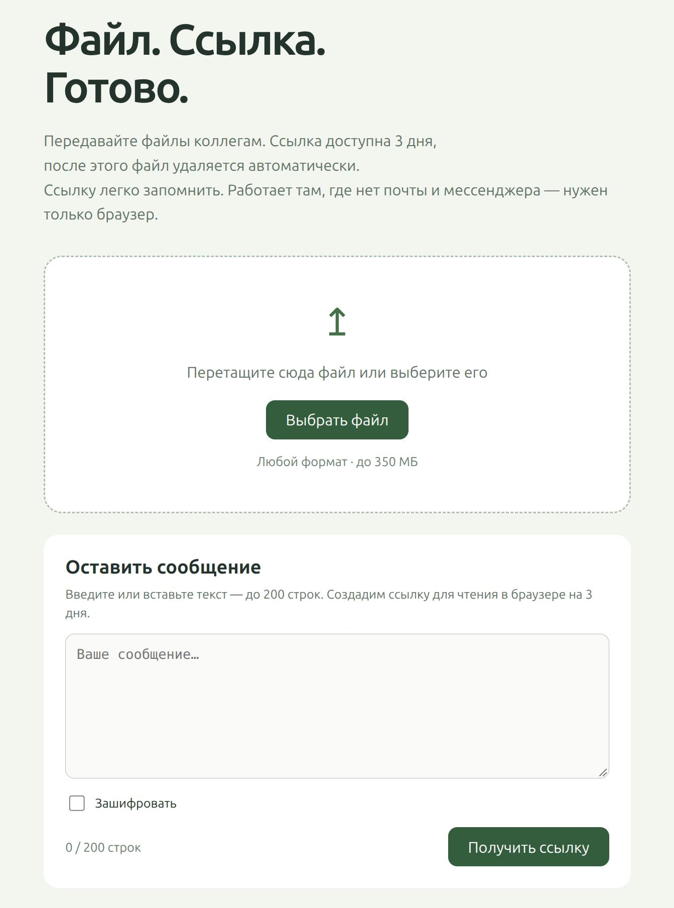
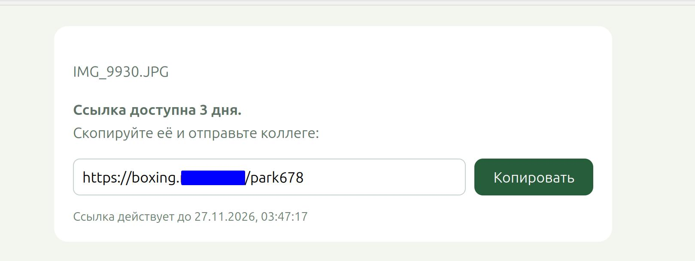

# NapiBox

NapiBox — файлообменник для корпоративной сети с небольшой нагрузкой.

- **Короткие ссылки легко запомнить и продиктовать.** Адрес файла состоит из английского слова и трёх цифр, например `/cat042`.
- **В чате с ИИ достаточно написать `cat042`.** Если ИИ-агент знает адрес вашего NapiBox и имеет к нему доступ, можно попросить «прочитай файл cat042». Агент сможет скачать файл по этой ссылке.
- **Текстовые сообщения можно зашифровать.** Задайте четырёхзначный PIN и отправьте получателю ссылку. Чтобы прочитать сообщение в браузере, он вводит PIN.
- **Для небольшой команды достаточно одного сервера.** Веб-интерфейс встроен в бинарник, файлы хранятся на диске. Отдельная база данных не нужна.

Файл может занимать до 350 МиБ, сообщение — до 200 строк. Ссылка действует 72 часа.



## Запуск

Для сборки на Linux нужен Go 1.22 или новее. Веб-интерфейс встроен в бинарник.

```sh
go test ./...
go build -buildvcs=false -o napibox .
./napibox
```

После запуска откройте [http://127.0.0.1:8080](http://127.0.0.1:8080).
Для доступа из локальной сети укажите IP сервера, например `NAPIBOX_ADDR=192.168.1.10:8080 ./napibox`.
Сервис принимает загрузки от всех, у кого есть доступ к этому адресу.



## Сообщения с PIN

В форме «Оставить сообщение» включите «Зашифровать» и задайте PIN из четырёх цифр.
Получателю понадобятся ссылка и PIN. На одну ссылку даётся пять попыток ввода
в минуту. При перезапуске сервиса счётчик сбрасывается.

Сервер шифрует текст перед записью на диск (AES-256-GCM). Для передачи текста
и PIN по сети используйте HTTPS. PIN не попадает в ссылку и журнал. Копия
данных вместе с серверным ключом позволяет перебрать все 10 000 вариантов PIN офлайн.

## Хранение

Каталог данных задаётся через `NAPIBOX_DATA` (по умолчанию `data`). Каждому
экземпляру NapiBox нужен свой каталог. Метаданные лежат в JSON рядом с файлами.
Каждая загрузка получает отдельную ссылку, даже если имя и содержимое совпадают.

Сервер закрывает ссылку сразу по истечении срока, а просроченные файлы удаляет
при запуске и затем раз в минуту. Если загрузка затронет резерв в 10 ГиБ, сервер прервёт её.

При переносе или резервном копировании сохраняйте каталог целиком. Ключ
`.encryption-key` нужен для чтения зашифрованных сообщений. Файлы `*.used`
резервируют старые ссылки, чтобы они не указывали на новые загрузки.

В `uploads.jsonl` записываются время загрузки (UTC), IP клиента, имя и размер
файла, полная ссылка и срок её действия. Журнал сохраняется после удаления файлов.
Ротацию нужно настроить отдельно. Если запись в журнал не удалась, сервис отклоняет загрузку.

## HTTP API

Пример загрузки из каталога репозитория. В теле запроса передаётся содержимое файла.

```sh
curl --data-binary @README.md 'http://127.0.0.1:8080/api/upload?name=README.md'
```

Ответ `201 Created` содержит путь `url` и срок действия ссылки `expires` (UTC).
Пустой файл сервер отклоняет.

| Операция | Запрос |
| --- | --- |
| Загрузить файл | `POST /api/upload?name=example.txt` |
| Создать сообщение | `POST /api/upload?name=message.txt&kind=message`, текст в теле запроса |
| Зашифровать сообщение | К запросу создания сообщения добавьте `&encrypt=1` и заголовок `X-Napibox-Pin` с четырьмя цифрами |
| Скачать файл или прочитать сообщение | `GET /{id}`. Для зашифрованного сообщения откроется форма ввода PIN |
| Прочитать сообщение по PIN | `POST /{id}`, поле `pin` в теле формы (`application/x-www-form-urlencoded`) |

Старые ссылки, в том числе `/f/{id}`, продолжают работать до истечения срока.
Просроченная ссылка возвращает `410 Gone`, после удаления файла — `404 Not Found`.

## Развёртывание

Для отдельной сборки на Linux x86-64 есть [скрипт сборки и проверки](deploy/build-native.sh).

[Служба systemd](deploy/napibox.service) запускает NapiBox от пользователя `napibox`.
Положите исполняемый файл в `/opt/napibox/current/napibox`, а настройки — в
`/etc/napibox/napibox.env`. Служба хранит данные в `/var/lib/napibox/data`.

Для HTTPS без прокси задайте адрес, сертификат и ключ в файле настроек.

```ini
NAPIBOX_ADDR=192.168.1.10:8443
NAPIBOX_TLS_CERT=/etc/napibox/tls/fullchain.pem
NAPIBOX_TLS_KEY=/etc/napibox/tls/privkey.pem
```

Сервис поддерживает TLS 1.2 и новее. После замены сертификата перезапустите службу.
Для перенаправления с HTTP задайте адрес прослушивания в `NAPIBOX_HTTP_ADDR`
и внешний HTTPS-адрес в `NAPIBOX_PUBLIC_URL`.

Если HTTPS обслуживает nginx, используйте [пример конфигурации](deploy/nginx/napibox-location.conf).
Проверьте адрес в `proxy_pass` (в примере `127.0.0.1:18080`), создайте `htpasswd`
и `trusted-clients.conf`. При пустом списке доверенных сетей nginx запрашивает пароль
у всех. Ограничьте прямой доступ к NapiBox, чтобы клиенты подключались через nginx.

Для записи IP клиента и HTTPS-ссылок в журнал укажите сеть прокси в
`NAPIBOX_TRUSTED_PROXIES` (для локального nginx — `127.0.0.1/32`).
Прокси должен сам выставлять `X-Real-IP` и `X-Forwarded-Proto`.

Проверка после установки загружает файл и два сообщения, одно из них с PIN.

```sh
python3 deploy/verify.py http://127.0.0.1:8080
```

При Basic Auth передайте вторым аргументом путь к закрытому JSON-файлу с полями
`url`, `username` и `password`.
